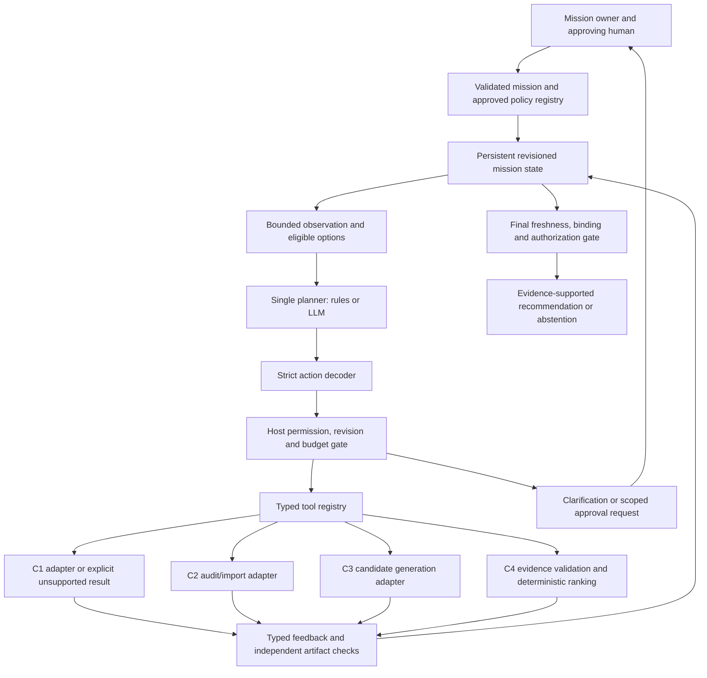

# Component 4: Adaptive Agent Technical Blueprint

Date: 2026-10-21. Overall status: **PROPOSED**, not approved or implemented.
Baseline: `feature/component4-agentic-ai` at `94b148c`.

See [evidence](research-evidence-review.md), [decisions](architecture-decision-records.md)
and [milestones and evaluation](implementation-evaluation-roadmap.md).
Schemas and tool names in proposed sections are design specifications, not APIs
that can currently be called.

## 1. Current boundary and migration constraints

Implemented C4 contracts are `MissionRequest`, `HazardEvidence`, `VehicleEvidence`,
`RankingMetricEvidence` and verification protocols in
[`contracts.py`](../../src/agentic_orchestration/contracts.py); `RankingPolicy` in
[`ranking.py`](../../src/agentic_orchestration/ranking.py); model transport types in
[`llm_planner.py`](../../src/agentic_orchestration/llm_planner.py); and
`PlannerAction`/`PlannerObservation` in
[`agent_controller.py`](../../src/agentic_orchestration/agent_controller.py).
Existing action decoding accepts only acquire, evaluate, clarification and stop.
The current observation omits urgency, tool feedback and evidence summaries.
The current controller rejects repeated action kinds and ends after evaluation.

The existing mission does not contain origin/destination coordinates. Existing
verifiers are injected trusted interfaces, not artifact-validation implementations.
`HostExecutionBudget` is in-memory and tracks provider/model calls and elapsed time;
it has no general tool-call or persistent-resume accounting. All these limitations
must be addressed explicitly, rather than treating this design as implemented.

### Baseline integration inventory

These are locally cached refs, not a claim about remote latest versions. Read
them with `git show REF:PATH`; their files are absent from the C4 checkout.

| Component/ref/commit | Existing operations and formats | Integration gaps |
| --- | --- | --- |
| C1 `origin/feature/component-1-hazard-susceptibility-modelling`, `92710d7` | `src/component_1_hazard_susceptibility/data_loader.py` loads GeoPackage factors/labels; `train_flood.py` and `train_landslide.py` train synthetic models; `predict_rasters.py:127` writes two float32 GeoTIFFs, NoData -9999, with synthetic/prototype tags. | Offline scripts with external fixed GIS paths; no service, combined-hazard implementation, immutable manifest or source observation validity. Generated rasters are not tracked. |
| C2 `origin/feature/component-2-road-network-graph-construction`, `2d6ec03` | `src/road_network/c2_api.py:450` implements GET audit/exports/roads/metrics endpoints; `c2_project_audit.py` validates/hashes artifacts. `scripts/c2_extract_sabaragamuwa_osm.py`, `c2_clean_validate_raw_network.py`, and road-network normalization/repair modules process GraphML. | API audits existing files, not refresh jobs. No tracked GraphML in this snapshot. Extraction time is not a live closure timestamp. Real repair requires approvals. |
| C3 `origin/component3-routing`, `06a98c6` | `src/route_optimization/loaders.py`, `attachment.py`, `graph_builder.py`, `snapping.py`, `baselines.py`, `pareto.py`, `metrics.py`, `scenarios.py`, `exporter.py`; library functions consume graphs/rasters/OD and return node paths, metric objects and GeoJSON. `contracts/schemas.py` defines exchange models. | No routing service or C4 adapter; no C4 snapshot/time/vehicle/coverage bindings. Unknown-as-zero paths, rounding, graph simplification and recommendation fallback need explicit treatment. |

C2 source fields include `(u,v,key)`, `osmid`, length, highway, direction and
access tags; GraphML exports do not retain original edge geometry. Its audit hash
establishes artifact identity, not correctness. C3's simplified `DiGraph` discards
parallel-edge keys/access details. Its recommendation function can relax screening;
its GeoJSON feasibility flag is not a C4 eligibility decision. No live hazard or
authoritative road-closure feed has been verified in any component.

## 2. Responsibilities and architecture

The planner chooses the next useful operation and a bounded reason code from
host-generated options. It interprets validated summaries, requests clarification,
proposes a permitted policy profile, and decides whether to stop. It does not
produce authoritative values or permissions.

The trusted host validates missions, resolves coordinates, issues tool options,
checks preconditions, obtains approvals, executes adapters, verifies artifacts,
maintains revisions/budgets, and releases recommendations. Numeric route metrics,
hard-constraint tests and ranking remain deterministic host operations. Component
owners retain responsibility for source methods and scientific limitations.



The dependency graph constrains validity, not one mandatory execution order.
Model concurrency and multi-agent execution are initially excluded. Benchmark
variants swap only the planner; all gates/tools remain identical.

## 3. Proposed common types and invariants

The following is a language-neutral schema specification. A name ending `Ref`
is an opaque host-issued identifier, not a filesystem path or arbitrary URL.
All objects are closed-key, versioned, immutable values. Booleans cannot stand
in for numbers; non-finite numbers and duplicate JSON keys are rejected.

| Type | Required fields and constraints |
| --- | --- |
| `MissionContextV2` | `mission_ref`, integer `mission_revision`, existing validated `MissionRequest`, `od_ref`, `policy_ref`, `purpose: SYNTHETIC_RESEARCH or REVIEW_ONLY`, allowed source classes. No field dispatch is initially supported. |
| `ODRecord` | `od_ref`, longitude/latitude pairs with explicit CRS, origin/destination meaning, approved snap-distance rule, source ref and version. Axis order is explicit; host validates bounds and transformations. |
| `ArtifactManifest` | `artifact_ref`, `snapshot_id`, SHA-256 digest, artifact kind, schema/version, immutable storage ref, source refs, source class, `built_at`, nullable `observed_at`, nullable `valid_until`, validity basis, nullable CRS/grid/extent metadata, producer/method version, parent snapshot IDs and validation report ref. UTC timestamps include timezone. |
| `EvidenceStatus` | `availability: AVAILABLE/MISSING/UNSUPPORTED/FAILED`, `freshness: FRESH/STALE/UNKNOWN/NOT_APPLICABLE`, `coverage: COMPLETE/PARTIAL/UNKNOWN`, verification state, reason-code list and manifest ref. Freshness and availability are separate. |
| `ToolFailure` | `kind: TRANSIENT/PERMANENT/MISSING_INPUT/UNSUPPORTED/INVALID_OUTPUT/CONTRADICTORY/STALE_BINDING/AUTHENTICATION/RATE_LIMIT/SECURITY`, fixed code, host-assigned retryability, optional validated retry-after duration, affected refs. No raw error body. |
| `ToolResult[T]` | tool/version, call ID, idempotency key, consumed state revision, `status: OK/RETRYABLE_ERROR/BLOCKED/UNSUPPORTED/FAILED`, payload `T` only for OK, otherwise `ToolFailure`, output refs, start/end UTC time, measured duration, consumed reservations, next state revision. Exactly one payload/failure branch. |
| `ToolOption` | `option_id`, tool ID/version, mission/state revision, host-bound typed argument digest, visible bounded argument summary, precondition report, required permission/approval scope, estimated cost class. It contains no executable handle. |
| `HumanDecision` | request ID, mission/revision binding, authenticated actor, allowed scope, approve/deny or typed clarification payload, expiry and audit event ID. A model string is never a human decision. |

Source classes initially distinguish `SYNTHETIC`, `STATIC_SUSCEPTIBILITY` and
`OBSERVED_EVENT_DATA`. A synthetic artifact is eligible only in a synthetic
experiment. Static susceptibility is a landscape-model output, not a verified
real-time event probability. If a source has no legitimate observation timestamp,
keep it null. Build time cannot be copied into `observed_at`. A domain-approved
validity policy is required before any such product can satisfy operational
freshness requirements; do not weaken the existing C4 gate to make it pass.

## 4. Typed tool registry and exact inputs/outputs

The registry is trusted host configuration. Each entry contains input/output
schema IDs, adapter version, capability availability, side-effect class, timeout,
output cap, source-class restrictions, permission predicate, precondition function,
idempotency behavior and error classifier. Unsupported adapters are registered as
unavailable; they must not masquerade as functioning tools.

| Proposed tool | Closed input record | Typed OK output | Eligibility and implementation boundary |
| --- | --- | --- | --- |
| `inspect_dependencies` | `{mission_ref, mission_revision}` | `DependencyReport{hazard_status, graph_status, routing_status, capability_statuses, available_manifest_refs, missing_fields, evidence_revision}` | Mission validated. Host inspection of approved artifacts; C2 audit may back part of it. No new hazard acquisition is implied. |
| `prepare_hazard_snapshot` | `{mission_ref, approved_source_ref, expected_parent_ref or null}` | `HazardPrepared{manifest_ref, validation_report_ref, source_class, coverage_summary}` | Source allowlisted, recomputation supported, required inputs available, write authorization if needed. Existing C1 batch prediction is potential backing, not an available refresh service. |
| `prepare_network_snapshot` | `{mission_ref, approved_source_ref, expected_parent_ref or null, approved_processing_profile_ref}` | `NetworkPrepared{manifest_ref, validation_report_ref, restriction_summary, closure_manifest_ref or null}` | Approved import/recalculation capability. Topology changes require separate scoped approval. No invented closure feed; absent closure evidence is explicit. |
| `generate_alternatives` | `{mission_ref, mission_revision, od_ref, graph_snapshot_id, hazard_snapshot_id, routing_profile_ref}` | `AlternativesGenerated{alternatives_ref, route_result_refs, bound_dependency_ids, coverage_report_ref, candidate_count, reachability_status, search_completeness}` | Required manifests verified/valid/aligned, OD resolved, policy profile eligible, vehicle restrictions resolved or explicitly unknown. Wrap C3 functions only after evidence gaps are addressed. |
| `evaluate_alternatives` | `{mission_ref, mission_revision, alternatives_ref, policy_ref}` | `EvaluationFeedback{evaluation_ref, outcome, eligible_count, rejection_reason_counts, metric_issue_codes, recommendation_ref or null, sensitivity_status}` | All refs bind to the current revision; host loads independently held authority and uses existing C4 validation/ranking. A selected result remains provisional until final release checks. |
| `propose_policy_profile` | `{mission_ref, mission_revision, proposed_profile_ref}` | `PolicyProposal{proposal_ref, applicability_report_ref, approval_required}` | Profile exists and is eligible for the validated mission. This records a proposal; it cannot activate policy or change weights. Human-approved host activation creates a new revision. |

The first five are the core evidence tools. The sixth is an optional controlled
preference-management extension; it must remain unavailable until a policy registry
and approval process exist. Human clarification/approval and stopping are controller
actions, not unauthenticated external tool results.

No function accepts model-generated raw Python, paths, URLs, hard limits, raw
weights, `verification_status` overrides or selected route IDs. A host-issued option
binds concrete inputs; choosing it selects a proposed operation, not an arbitrary
new mission snapshot. New artifacts are first validated, then adopted by an
authorized state transition. Failed outputs never become active.

### Action and observation schemas

Proposed `c4.adaptive-action/2.0.0` is a discriminated closed union:

```text
CallTool       {schema_version, kind="call_tool", state_revision, option_id}
Clarify        {schema_version, kind="request_clarification", state_revision, topic}
RequestReview  {schema_version, kind="request_approval", state_revision, proposal_ref}
Stop           {schema_version, kind="stop", state_revision, reason_code}
```

`topic` is a finite host-issued set such as missing OD, ambiguous destination,
missing snapshot source, policy ambiguity or host review. `proposal_ref` must
identify a pending host-recorded proposal. Stop reason is an enum, not a claim
that a route is safe. Unknown keys, multiple actions and invalid revisions fail.

Proposed `AdaptiveObservation` contains:

- Schema/prompt version, mission reference/revision, state revision, step and phase.
- Mission type, validated urgency, vehicle class, missing required field names,
  active approved policy ID/version and bounded criteria/constraint summaries.
- Hazard and graph snapshot IDs, source classes, age/validity basis, freshness,
  coverage, independent verification status and source limitations.
- OD-resolution status, snap distance and compatibility status, without sensitive
  coordinates in remote model input unless explicitly authorized.
- Alternative-set bindings, counts and search-completeness status; no authoritative
  metrics are computed from model text.
- Available tool capabilities and eligible `ToolOption` summaries; missing
  capabilities and explicit unsupported-operation codes.
- Last typed feedback: tool status/failure class, evaluation reason codes and
  affected dependencies. Bounded event summaries distinguish changed evidence
  from unchanged repeated failure.
- Remaining model/tool/time/retry budgets, pending human requests and permitted
  next topics/actions. Budget values are observations, never writable options.

The host owns prompt construction and injects fixed instructions separately from
serialized observation data. Tool narrative is not promoted to instructions.
Observation caps and a deterministic omission policy are versioned; mandatory
failure/eligibility fields cannot be dropped to fit a context window.

The current `ModelRequest`/`ModelCallRecord` have fixed v1 prompt/decoder version
fields. A future backward-compatible migration must make host-supplied validated
version identities representable, preserving v1 defaults and tests, before using
the adaptive prompt through existing transports. Do not execute a v2 prompt while
auditing it as v1, or bypass the current strict decoder by coercing dictionaries.
A separate adaptive planner/controller path is proposed; v1 remains unchanged.

## 5. Persistent state, caching and invalidation

Proposed `MissionState` stores mission and state revisions; phase; active/pending
policy; current graph/hazard/closure manifests; dependency DAG; OD binding;
alternative/evaluation refs; pending human request; failure history; action
fingerprints; durable reservations; wall deadline and cumulative active time.
It stores refs to immutable artifacts, not mutable shared graphs.

Persistence initially targets a local transactional store with compare-and-swap
revision updates. This is a proposed local research design, not existing durable
infrastructure or a distributed guarantee. Reserve before external work; record
pending call IDs; commit validated output and resulting state together. A crash
with uncertain completion requires adapter reconciliation. Never rerun a mutating
operation merely because no response was recorded.

Cache key:
`(tool_version, canonical_input_digest, parent_snapshot_ids, mission_revision,
policy_version, source_class, verification_version)`. A cache hit is reusable only
after checking source validity, unchanged parents and applicable permissions.
Unchanged verified dependencies are reused; new artifacts invalidate descendants
only. Graph/closure changes invalidate routes; hazard changes invalidate attached
hazard metrics/routes; preference-only changes can invalidate evaluation while
retaining compatible candidates. If route search was policy-dependent, preference
changes may also require regeneration: reuse must check its search profile.

Hashes identify content; trusted registry membership identifies authorized
artifacts. Neither proves external truth. Manifest identity includes configuration,
producer and dependency versions, not only output bytes. Advancing a graph
snapshot must not relabel old candidates as if they used the new graph.

## 6. Decision loop, recovery and loop prevention

1. Validate mission and compute the current dependency view. Stop/suspend if
   required input or approval is missing. Read-only host state assembly is not an
   unconditional external tool call.
2. Compute genuinely eligible operations, including useful alternatives. A
   dependency graph permits either independent preparation order where valid.
3. Ask the selected planner for one action. Decode, check revision/option identity,
   permission, preconditions and reservation atomically before dispatch.
4. Execute one bounded tool attempt. Validate the result envelope and independently
   check claimed artifacts. Retain typed feedback, including failures.
5. Update/invalidate state, rebuild options and repeat. Evaluation failure can
   lead to a supported targeted repair request or abstention; success still needs
   final release checks.

| Feedback | Proposed permitted response |
| --- | --- |
| Transient failure | One explicitly authorized retry when meaningful, or a separately approved equivalent source. Same idempotency identity for uncertain side effects. |
| Missing/stale dependency | Prepare that dependency if supported; otherwise clarify or abstain. Do not refresh unrelated valid artifacts. |
| Changed snapshot | Invalidate affected descendants, adopt only verified authorized new revision, regenerate/revalidate as required. |
| Unknown/partial hazard or vehicle evidence | Obtain supported evidence or abstain; never substitute zero or invent compatibility. |
| Permanent/unsupported operation | Remove that option; use an approved valid path if any, otherwise human review/stop. |
| Authentication/rate limit/security | Stop the affected provider session, no automatic retry, upgrade or hidden model switch. |
| All supplied routes fail | Request a distinct authorized search only when search-space evidence justifies it; otherwise stop with candidate-set infeasibility, not graph-wide impossibility. |

Fingerprint `(tool, bound_inputs, dependency_revision, failure_class)` prevents
unchanged repetition. A repeated call needs changed evidence, explicit retry
eligibility or an unreconciled idempotent operation. Progress means validated new
information, resolved input or a permitted completed transition, not another
model explanation. Maintain bounded rejection/no-progress counts. Recovery cannot
be used to search repeatedly until the verifier returns a desired answer.

### Proposed experimental budgets

These are initial test settings requiring review, not evidence-based emergency
thresholds: 8 model attempts, 12 tool attempts, 20 controller steps, 120 seconds
active elapsed time, at most 1 explicit retry per unchanged tool/input identity
(2 attempts total), and 2 consecutive no-progress or invalid proposals. A model
attempt uses temperature 0, up to 2,048 completion tokens, bounded observation and
65,536-byte HTTP envelope / 4,096-byte action limits. Per-call timeouts cannot
exceed remaining active time; initially cap individual transport/tool attempts
at 30 seconds where the implementation can enforce it.

Every nested external tool call is metered. Map legacy provider reservations to
the same ledger without double-counting a single invocation or hiding retries.
Local verification cost remains in elapsed time even when it is not an external
tool call. A future general-tool budget must remain compatible with existing
`ExecutionBudget` consumers; current provider counters are not silently renamed.

Counters survive run IDs, pause/resume and crashes. Human waiting pauses the
active-time clock only under a recorded rule, not freshness. An illustrative
24-hour wall expiry prevents indefinite pending sessions; domain owners must
replace it with an appropriate research/operational policy. Budget exhaustion is
sticky. Synchronous callbacks/DNS can overrun; late results cannot be released.

## 7. Safety, preferences and human continuation

Hard limits stay separate from utility weights. All route selection continues
through `validate_candidates()` then `rank_candidates()` with independently
injected authority. Human approval cannot authorize false verification or waive
a hard limit inside the same mission. A legitimate changed requirement creates
a separately validated mission revision and is audited.

An approved profile registry binds mission applicability, time/exposure weights,
normalization interpretation, elicitation evidence, approver, version and validity.
Initial profiles are expert-defined; AHP/BWM are offline elicitation options.
The LLM may propose only eligible profile refs. Unknown/ambiguous profiles require
review. Priority is not inferred from a mission label or urgency word. Existing
ranking supports only its two criteria; extra criteria require a separate reviewed
contract/algorithm change and are not smuggled into the weights.

Clarification produces `SUSPENDED_FOR_INPUT`; approval produces
`SUSPENDED_FOR_APPROVAL`. The host issues a scoped, expiring continuation token
bound to mission/state revision and request topic. It validates the authenticated
reply, rejects replay/stale/denied decisions, rechecks all evidence ages and source
versions, advances state and resumes within retained budgets. Human text is data,
not code or an instruction to override verification. A denied/expired request
ends or re-clarifies only within the existing limits.

### Spatial and evidence acceptance checklist

- **Unknown hazard:** retain NoData/NaN/outside/partial coverage as unknown. Existing
  C3 zero-fallback paths cannot back a verified COMPLETE result. Reject or bypass
  those paths with independently computed evidence; do not change C1-C3 here.
- **Meaning:** label susceptibility/model outputs explicitly. No claimed real-time
  event probability without separate scientific calibration and observations.
- **Alignment:** validate CRS, axis order, grid transform, spatial extent and units;
  transform coordinates explicitly. A readable GeoTIFF is insufficient.
- **Geometry and keys:** retain original directed `(u,v,key)` identity through
  routing transforms and verify every chosen edge. C2 straight segments may be
  legitimate unsimplified segments, but do not claim recovered original curved
  geometry. C3 simplification requires a validated reverse mapping or remains unsupported.
- **Coverage:** record valid/unknown portions and the method. Finite point sampling
  alone is not proof of complete spatial coverage or exact maximum raster hazard.
- **Vehicle:** verify access restrictions over every chosen directed edge against
  host-owned vehicle rules; missing tags are not permission by default.
- **Metrics:** recompute independently or retrieve from a trusted result store;
  bind units `s`, `m`, `hazard*m`, method versions, rounding/precision and snapshots.
  Do not round before hard-limit checks or accept a digest as numeric verification.
- **Release:** verify current bindings and permitted freshness at evaluation and
  before release. Historical replay remains explicitly historical. No closure
  awareness is claimed when no authoritative closure source exists.

## 8. Three different valid proposed paths

These are future synthetic acceptance examples, not executed results. Assume the
host has already validated the mission, profile and available artifact registry.

**Path A: reuse verified work.** Graph, hazard and compatible alternatives are
fresh and bound correctly: `evaluate_alternatives -> release or abstain`.
No C1, C2 or C3 recomputation is useful. If alternatives are absent, call only
`generate_alternatives -> evaluate_alternatives`.

**Path B: missing hazard, valid graph.** Supported synthetic hazard preparation
is available: `prepare_hazard_snapshot -> generate_alternatives ->
evaluate_alternatives`. Reuse the graph. If preparation is unsupported, the valid
path is clarification/abstention, not fake hazard generation.

**Path C: graph change during a mission.** A new approved synthetic graph/closure
manifest invalidates routes but not the hazard surface: `prepare_network_snapshot
-> generate_alternatives -> evaluate_alternatives`. A transient generation
failure permits one explicit retry; a permanent failure produces human review or
abstention. Old route results never receive the new graph ID by relabeling.

An additional policy-only path can reuse policy-independent verified alternatives:
`propose_policy_profile -> request_approval -> validated resume ->
evaluate_alternatives`. Unsupported new preferences suspend rather than infer
weights. Independent graph/hazard preparation may occur in either order when
both are needed; the agent is not required to traverse C1 then C2.

## 9. Audit, security and unsupported behavior

Each event records mission/state revision, planner/provider/model identity,
schema/prompt/decoder versions, redacted observation digest, proposed option,
eligibility decision, reservations, tool result/failure, dependency changes,
latency/usage, human approvals and recommendation outcome. Retain immutable
artifact refs and access-controlled replay inputs separately. A hash alone cannot
recreate a deleted prompt or source; retention must be explicitly governed.
Public exports omit private coordinates, mission labels, raw tool/provider bodies
and credentials. Current baseline audit request objects need redacted export.

Use strict schemas, size/time caps, source allowlists, least privilege and
independent numeric checks. Treat all tool narrative as untrusted. Display an
approved bounded summary only when needed; never concatenate tool instructions
into the system message. The host rejects forged options, stale revisions,
arbitrary endpoints, file traversal, unsolicited tool arguments and permission
claims embedded in results. Do not deserialize untrusted Joblib/pickle artifacts;
model binaries require trusted acquisition/manifest verification before use.

Example unsupported response specification:

```json
{
  "schema_version": "c4.tool-result/2.0.0",
  "tool_id": "prepare_hazard_snapshot",
  "tool_version": "prototype/1",
  "status": "UNSUPPORTED",
  "failure": {
    "kind": "UNSUPPORTED",
    "code": "approved_source_adapter_unavailable",
    "retryable": false,
    "affected_refs": []
  }
}
```

The example is a failure-branch projection; the complete envelope also requires
call/revision/timing/reservation fields from Section 3. No fallback artifact is
returned. Real closure feeds, real-time hazard ingestion, vehicle-access authority,
distributed durability, automatic field dispatch and online learning remain
unsupported until separately implemented and validated.
